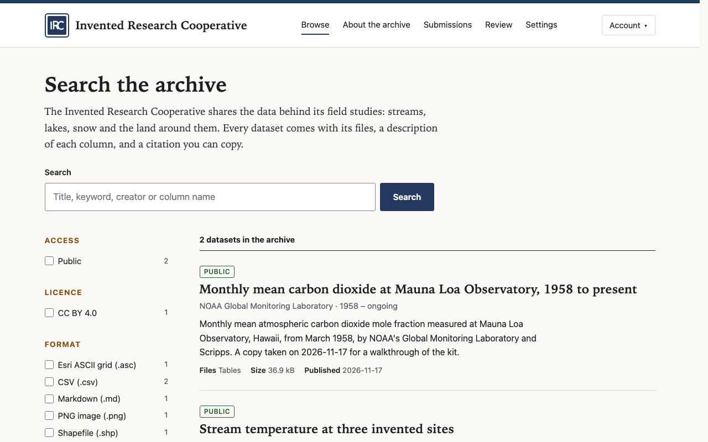
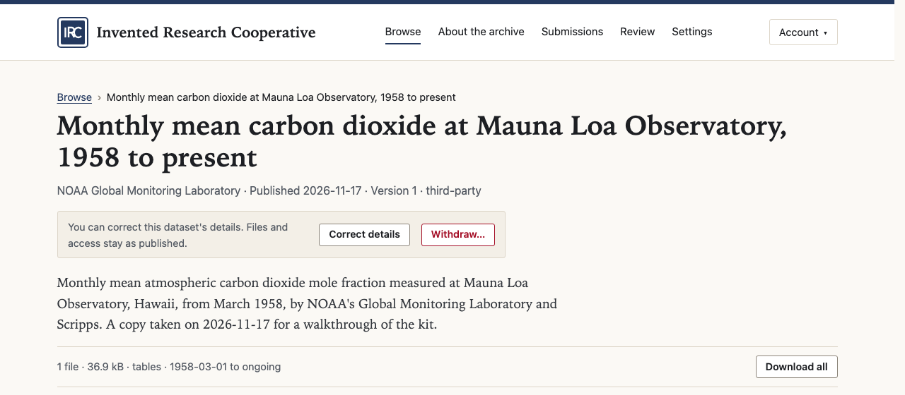
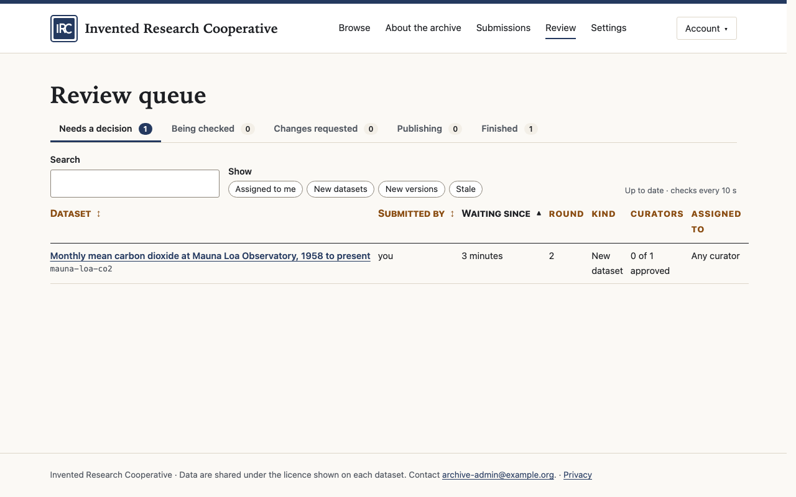
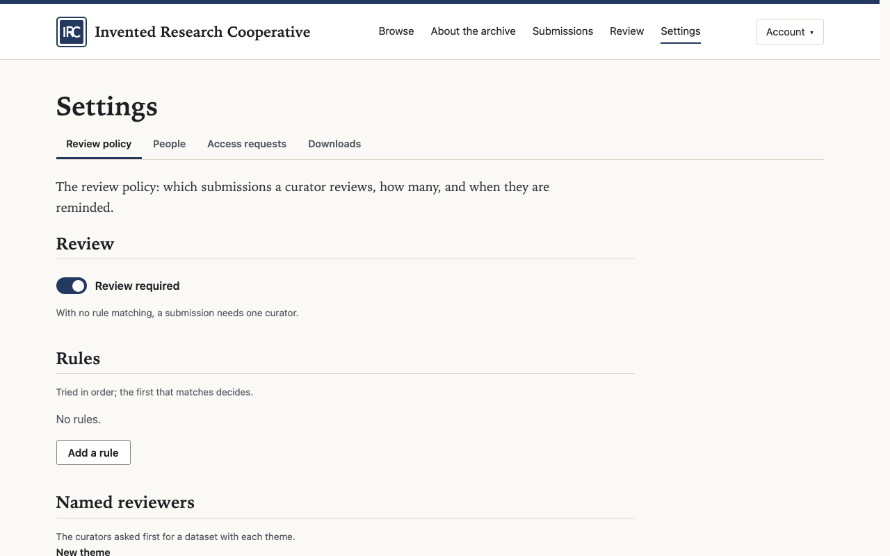

# research-archive-in-a-box

research-archive-in-a-box is a kit for running a research data archive: a place where a research group publishes its datasets so that other people can find, cite and download them. A field station, for example, can use it to check its plot data on a laptop, submit it to its own archive in its own AWS account, have a curator review it, and publish it at a stable address with a search page, a citation and, if it wants, a DOI (a Digital Object Identifier, a permanent link such as `https://doi.org/10.1234/abcd` that keeps resolving even if the archive moves).



## What a dataset looks like here

A dataset travels as a package. A package is a plain folder holding the data files, a manifest called `datapackage.json` that describes them (title, description, contributors, licence, and every column of every table), and `checksums.sha256`, which records a SHA-256 checksum of each file so that a changed or damaged file is noticed. The folder [`examples/sample-package`](examples/sample-package) is one: hourly stream temperatures from three invented sites. The manifest follows the [Frictionless Data Package](https://datapackage.org/) standard, so other tools that read Frictionless packages can read it too. [docs/guide/packages.md](docs/guide/packages.md) explains how to make one from a CSV file.

## Three ways in

### Check a package with cruise

`cruise` is the kit's command-line tool. It runs on your own machine, with no account and no network, and tells you what a package is missing before anyone else sees it. Install it with [uv](https://docs.astral.sh/uv/), at a release tag:

```
uv tool install "git+https://github.com/schuettc/research-archive-in-a-box@v0.1.1#subdirectory=packages/tool"
cruise --version
```

Your first command checks one package folder. In a clone of this repository, try it on the sample package:

```
cruise diagnose examples/sample-package
```

It answers in three groups of questions (can I find it, can I understand each column, can I trust the values), gives each problem a fix, and ends with a score and a verdict. On the sample package the verdict is `publishable, with 4 warnings`; one of them is that the column `battery_v` has no description. `cruise set` writes a fix into the manifest and rewrites `README.md` and `checksums.sha256` to match:

```
cruise set examples/sample-package description "Logger battery voltage, in volts." --resource logger --column battery_v
```

`cruise audit <folders>` ranks every package under some folders, worst first, so you can see where to start. [docs/guide/packages.md](docs/guide/packages.md) covers all three commands, with their output.

### Run an archive

An archive is a deployment of this kit: a web site with a search page, a page per dataset, sign-in, a submission form and a review queue, backed by storage and functions in your AWS account. Each copy you deploy is a stage, such as `prod`, or `dev` for trying changes first; every stage gets its own site and its own data. You describe the archive in one file, `archive.yaml`: its name, the profiles and required fields its packages are checked against, its brand (how the site looks), its stages, and any optional modules (DOIs, a custom domain, email through Amazon SES, semantic search).

To run one you need:

- an AWS account the archive will live in, with the AWS CLI signed in to it;
- a fork of this repository on GitHub, with GitHub Actions turned on, and the GitHub CLI (`gh`) signed in;
- [Claude Code](https://claude.com/claude-code), which runs the setup with you;
- on your machine, [uv](https://docs.astral.sh/uv/), Node 24 or later and [just](https://just.systems/).

Running an archive incurs AWS costs in your own account; [docs/guide/running-cost.md](docs/guide/running-cost.md) lists what it pays for.

Clone your fork, open it in Claude Code and ask it to set up the archive. Its `deploy-archive` skill (in `.claude/skills/deploy-archive/`) checks these prerequisites, writes `archive.yaml` with you, connects GitHub Actions to your AWS account, and pushes to `main`. From then on CI (the repository's GitHub Actions workflow) deploys every stage on each push to `main`; you never deploy the archive from your laptop. The skill also makes the first admin, publishes a seed dataset and checks the site answers. [docs/guide/deploying.md](docs/guide/deploying.md) walks through each step, and [docs/guide/archive-yaml.md](docs/guide/archive-yaml.md) lists every setting in `archive.yaml`.



Once it runs, people use it through the web app by role. A reader searches and downloads; a contributor submits packages; a curator reviews submissions in the review queue and publishes them; an admin gives people roles and decides who may see restricted data. Anyone can create an account, unless the archive is set to invitation only, and a new account has no role until an admin gives it one. [docs/guide/using-the-archive.md](docs/guide/using-the-archive.md) describes each role's screens, and [docs/guide/running-cost.md](docs/guide/running-cost.md) explains what costs money while it runs.





### Use the Claude Code plugin

The `cruise` plugin lets Claude Code work with an archive for you: find and download its data, check and fix a package with the archive's own rules, submit it, and review submissions as a curator. Nothing is written to a manifest or sent to the archive without your yes. It needs uv. In Claude Code:

```
/plugin marketplace add schuettc/research-archive-in-a-box
/plugin install cruise@research-archive-in-a-box
```

On Claude Code 2.1.275 or later, one line does both:

```
/plugin install cruise --marketplace schuettc/research-archive-in-a-box
```

The plugin's MCP server (a small program Claude Code starts to give it the archive's tools; here `archive-mcp`, in `packages/agent`) runs on your own machine and signs in on the archive's own sign-in page, which it opens in your browser. Its skills, `find-data`, `submit-dataset` and `review-submission`, ask for your archive's address the first time they need it.

## Documentation

The guide, for people deploying and using an archive:

- [Packages](docs/guide/packages.md): what a package is, how to make one, and `cruise diagnose`, `audit` and `set`.
- [archive.yaml](docs/guide/archive-yaml.md): every setting, with its type, default and an example.
- [Deploying](docs/guide/deploying.md): setting up an archive with the skill and CI, updating it from upstream, and tearing a stage down.
- [Using the archive](docs/guide/using-the-archive.md): the web app for readers, contributors, curators and admins.
- [Running cost](docs/guide/running-cost.md): what an archive pays for, and what costs almost nothing when idle.

The optional modules and curating:

- [DOIs](docs/dois.md): giving each published version a DataCite DOI.
- [A custom domain](docs/domain.md): serving a stage on its own name through Route 53.
- [Email through SES](docs/email.md): sending account emails from the stage's own domain.
- [Curating published datasets](docs/curating.md): corrections, withdrawal and restore, embargoes and download counts.

For people changing the kit: [Architecture](docs/architecture.md), the packages and how a submission becomes a published dataset.

## Layout

```
packages/
  contract/   Python: archive-contract, the package and archive.yaml models and their JSON Schema
  tool/       Python: cruise, the command-line tool that checks and edits packages
  backend/    Python: the Lambda functions behind the archive's API and pipeline
  infra/      TypeScript: the CDK construct (ResearchArchive) and the app CI deploys
  web/        TypeScript: the React and Vite web app
  agent/      Python: the Claude Code plugin, its MCP server (archive-mcp) and skills
  client/     Python: browser sign-in to an archive, for the MCP server
examples/     the sample package, an example brand (logo and favicon), and femc, an example converter
              that turns an existing data portal's datasets into packages
docs/         the guide, the architecture page and the module docs
```

Python packages form a uv workspace (`pyproject.toml`); TypeScript packages form an npm workspace (`package.json`).

## Develop

Needs uv, Node 24 and [just](https://just.systems/).

```
uv sync --all-packages
npm ci
just check
```

`just check` runs every format check, lint, type check and test in both languages, plus the schema drift check. Inside a clone, `uv run cruise` runs the tool from the source.

To try the web app locally against a deployed stage, run `ARCHIVE_DEV_SITE=https://<stage domain> npm run dev -w packages/web`. Vite then proxies `/api/`, `/auth-config.json` and `/data/` to that stage; without the variable, `npm run dev` is unchanged. Uploads, the findings report and file Preview fail locally, because the stage's storage refuses a localhost origin: check those on the stage itself.

## License

MIT
