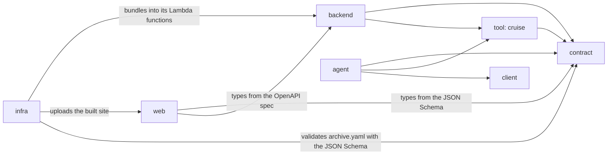
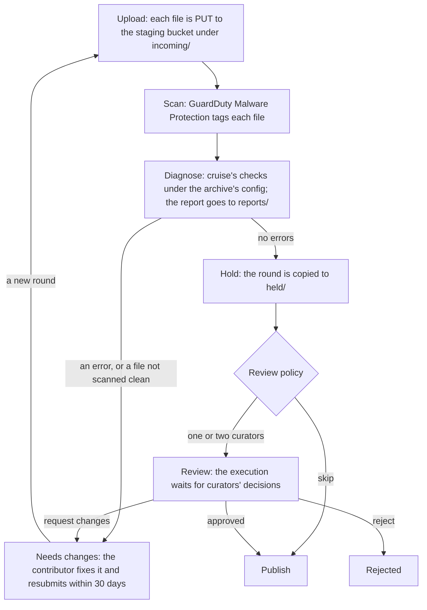
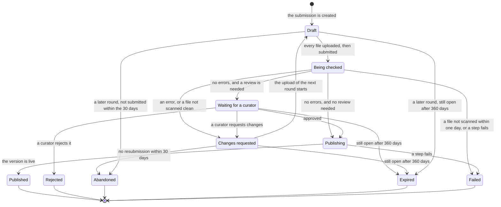
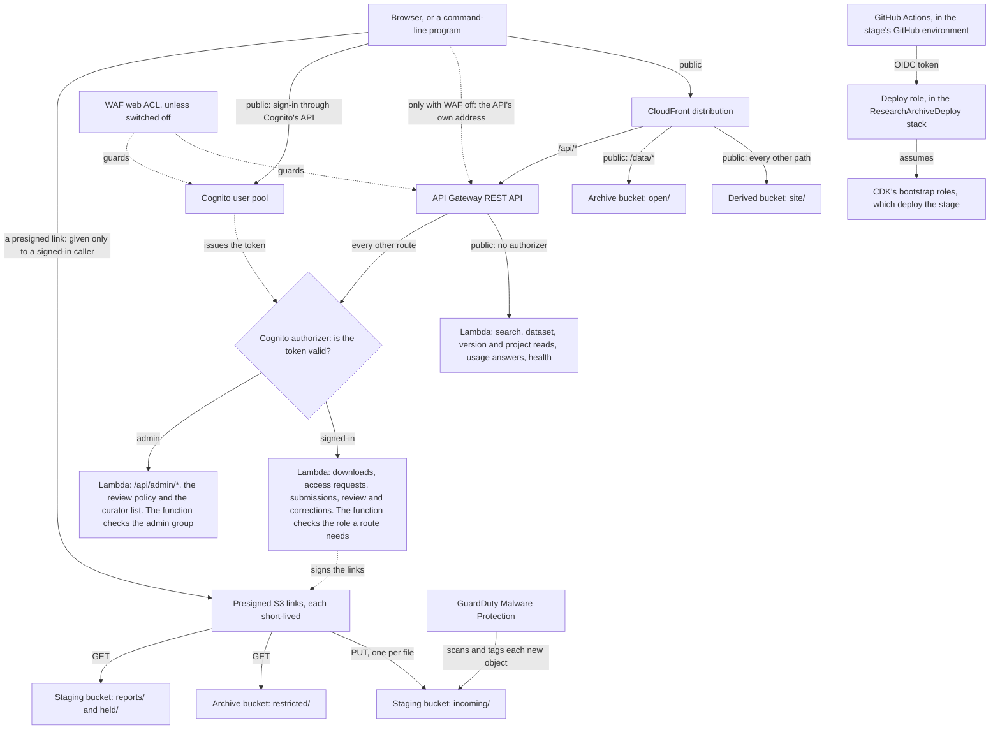
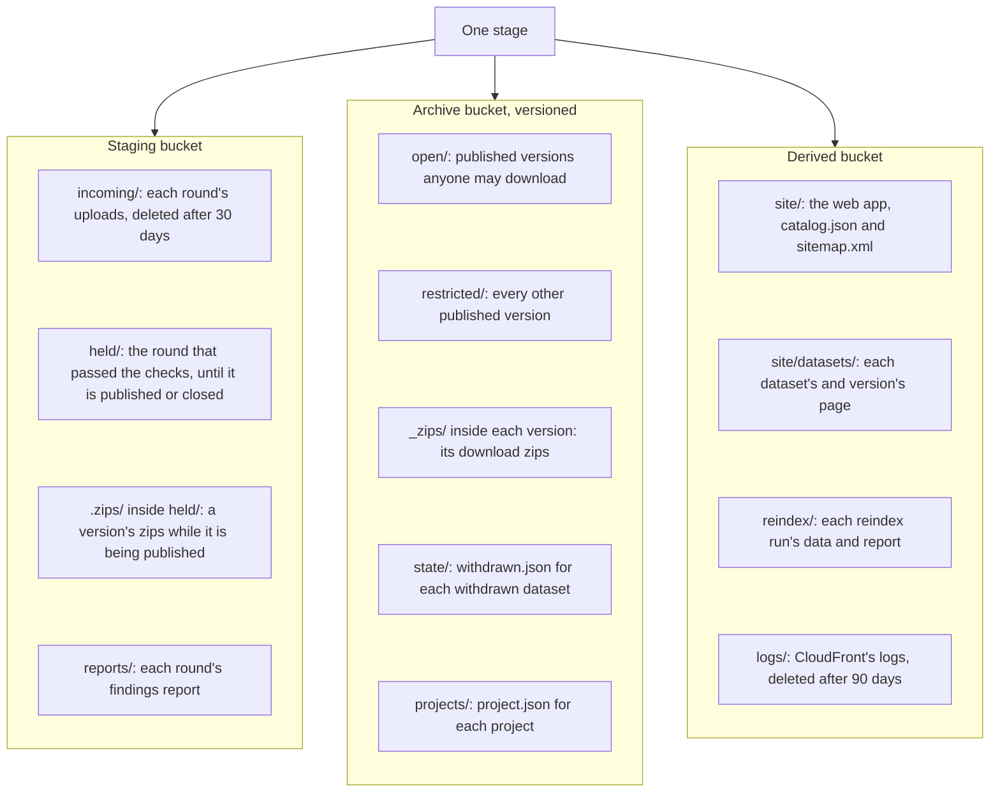

# Architecture

This page is for people who want to change the kit or understand how it is built. It describes the packages and how they depend on each other, how a submission becomes a published dataset, what one stage deploys, and the main design decisions with the reason for each. For running an archive, start with the [README](../README.md) and the [guide](guide/deploying.md).

## Terms

A **package** is a folder holding a dataset's data files, a manifest called `datapackage.json` that describes them, and `checksums.sha256`, which holds a SHA-256 checksum of each file. [`examples/sample-package`](../examples/sample-package) is one. The manifest is a [Frictionless Data Package](https://datapackage.org/) with a few additions, each under the `archive:` prefix, such as `archive:methods`.

A **finding** is one problem a check reports about a package, with a severity (`error`, `warning` or `note`), where it is, the evidence and a fix. For example, `field.description-missing` on the column `logger.battery_v` of the sample package is a warning.

A **stage** is one deployed copy of the archive, such as `prod` or `dev`, with its own site, storage and accounts. The stages are listed in `archive.yaml`, the one file that configures an archive.

A **submission** is one package sent to a stage for publishing. Each time the contributor sends it again after a change, that is a new **round** of the same submission.

## The packages

The repository holds seven packages: five in Python, in a uv workspace, and two in TypeScript, in an npm workspace.

| Package | Language | What it is |
| --- | --- | --- |
| `contract` (`archive-contract`) | Python | The Pydantic models of a manifest and of `archive.yaml`, the profiles (`core` and `ecology`) that say which fields an archive requires, the finding model, the review policy, and the EML, DataCite and schema.org conversions. It writes the JSON Schema the other languages read. |
| `tool` (`cruise`) | Python | The command-line tool: `cruise diagnose`, `audit` and `set`. It holds the quality rules and the score. |
| `backend` (`archive-backend`) | Python | The code of every Lambda function: the API, the ingest pipeline, the reindex, curation, access requests and the scheduled jobs. |
| `client` (`archive-client`) | Python | Browser sign-in to an archive, giving a command-line program a short-lived token. |
| `agent` (`archive-agent`) | Python | The Claude Code plugin: the MCP server `archive-mcp` and the skills `find-data`, `submit-dataset` and `review-submission`. |
| `infra` | TypeScript | The CDK construct `ResearchArchive`, which builds a whole stage, and the two CDK apps: the default app, which CI deploys, and the deploy-access app. |
| `web` | TypeScript | The React web app, built by Vite to static files. |

They depend on each other like this, where an arrow points from a package to one it uses:

The links between the two languages are generated files, not imports. `just schema` writes the contract's JSON Schema to `packages/web/src/schema/archive-contract.schema.json`, and the TypeScript type of `archive.yaml` that the construct uses from it. `just openapi` writes the API's OpenAPI spec from the backend's routes, and `just web-types` turns both into the web app's types. `just check-schema`, part of `just check`, fails when any of these differs from what the code would write now.

## From submission to published dataset

A contributor submits a package from the web app or from the Claude Code plugin. Each submission runs as one execution of the durable ingest function, named by the submission's id, from the first upload to its end.

1. **Upload.** The submissions API hands out one presigned PUT per file, each requiring the file's SHA-256, and the files land in the staging bucket under `incoming/<submission>/<round>/`. Then the API starts the ingest execution.
2. **Scan.** GuardDuty Malware Protection for S3 scans every new object under `incoming/` and tags it with its result. The ingest waits until every file of the round has a tag, backing off up to an hour between checks; a file still unscanned after a day fails the submission with an alert to the admins.
3. **Diagnose.** If the scan found nothing, the ingest first compares each stored file's size and SHA-256 with what the submission declared, and a file that differs blocks the round; then the ingest downloads the round and runs `cruise.diagnose` on it with the archive's `archive.yaml`, so the server applies the same rules `cruise --config archive.yaml` applies on the contributor's laptop. The report goes to the staging bucket under `reports/`, where the web app shows it. Any `error` finding blocks the round, and so does any file the scan did not report clean: the submission is marked as needing changes, and the execution waits up to 30 days for the contributor to resubmit.
4. **Review.** A round with no errors is copied to `held/`, each copy checked against the file's declared SHA-256 and carrying its scan result (a copy that differs ends the submission as `failed`), and matched against the review policy, which an admin sets in the web app's Settings. The policy says whether the round is reviewed, by one curator or two. While it waits for decisions, the execution reminds the curators on the policy's days and marks the submission stale after its last day. A curator approves, rejects, or requests changes, which sends it back to the contributor for another round.
5. **Publish.** An approved round, or one the policy lets through without review, is published in a series of steps, each safe to repeat: claim the next version number; fill in the manifest and regenerate its README and checksums; build the version's download zips from the held files, beside them in the staging bucket; copy the files and the zips to the archive bucket, under `open/` for public data and `restricted/` for the rest, checking each file against `checksums.sha256` and writing the manifest last; write the version's items into the active catalog table, which is the step that makes the version live; write the dataset's HTML page; register a DOI if the module is on; rewrite the catalog file and the sitemap; start the dataset's lifecycle run, which moves an older version's files when the new version made the dataset stricter; and finish, which empties the submission's `held/` folder. The archive bucket is versioned and keeps whatever is written to it, so a version is built in the staging bucket and nothing of it is in the archive bucket until the copy step; a reindex finds a version by its manifest, which arrives last. A publish that fails before the version is live removes what its copy step wrote.
6. **Reindex.** Everything outside the archive bucket can be rebuilt from it. `just reindex <stage>` starts a durable function that reads every published manifest, bulk-loads the catalog items into whichever of the two catalog tables is not in use, switches to that table only when the load completes, and then rewrites the catalog file, the sitemap and every dataset's page. Publishing does not need it; it is the repair and migration path.

Every wait in an execution is capped so that a submission still open after 360 days ends as `expired`, before the one-year limit on a durable execution would end it without a record. A step that fails after its retries ends the submission as `failed` and alerts the admins. One invocation of the function runs for at most 15 minutes, so each step that reads or writes a whole package (hold, zips, copy) is preceded by a one-second wait: the wait ends the invocation, and the step starts the next one with the full 15 minutes.

The statuses a submission passes through, as the web app names them, and every way it ends:

A first-round draft that is never submitted has no execution, so it stays a draft. A draft of a later round is different: the execution is still waiting for the resubmission, so a contributor who starts the next round's upload and never submits it ends as **Abandoned** when the 30 days run out, or **Expired** at 360 days. A fault in the pipeline at any other point, such as a callback it can't read, also ends the submission as **Failed**.

After publishing, a curator or an admin can correct a dataset's details; only an admin can withdraw it, restore it or move its embargo. Each of those records the change at once and hands the file moves to a separate lifecycle function, as [curating.md](curating.md) describes.

## What a stage deploys

All of a stage is one CloudFormation stack, `ResearchArchive-<stage>`, built by the `ResearchArchive` construct. Inside it:

- **Storage:** three S3 buckets. The staging bucket takes uploads (`incoming/`), keeps checked rounds (`held/`, with a version's zips while it is being published) and reports (`reports/`). The archive bucket keeps published data (`open/` and `restricted/`), each withdrawal's record (`state/`) and project records (`projects/`). `state/<id>/withdrawn.json` holds when, by whom and why the dataset `<id>` was withdrawn, so that a reindex keeps the withdrawal. `<version>/_zips/`, inside each published version's folder, holds that version's download zips: `all/package.zip` with every file, and one zip for each resource that has more than one file. The derived bucket keeps the site (`site/`), reindex files (`reindex/`) and CloudFront's logs (`logs/`).
- **Tables:** DynamoDB tables on demand: two catalog tables, A and B, with a parameter naming the active one, and one table per kind of record (submissions, review events, settings, access requests, user profiles, account events, download counts, usage responses).
- **Accounts:** a Cognito user pool. Anyone can sign up with a confirmed email, unless the stage is by invitation, and gets no role; an admin gives roles.
- **API:** an API Gateway REST API under `/api`, with throttling and a Cognito authorizer, in front of the read, submissions, access and curation functions.
- **Web:** one CloudFront distribution serving the web app and dataset pages from `site/`, open data from `open/` under `/data`, and the API under `/api`.
- **Pipeline:** the durable ingest function and GuardDuty Malware Protection on the staging bucket's `incoming/` prefix; the durable reindex function; the lifecycle function.
- **Scheduled jobs:** the daily download rollup from CloudFront's logs, the daily lifecycle sync for ended embargoes, and the weekly integrity check of every archived file against its checksums.
- **Operations:** an alert topic, a monthly budget alarm and a dashboard fed by every function's alarm.
- **Optional modules.** On unless switched off: WAF on the API and the user pool, with a limit on the API requests one address may make. Each off by default: S3 Object Lock on the archive bucket; embeddings for semantic search (Amazon Titan Text Embeddings v2 through Bedrock, with a vector index on the catalog tables); DOIs through DataCite; a custom domain, which adds a second stack, `ResearchArchive-<stage>-Certificate`, in us-east-1, where CloudFront takes its certificates from; and email through SES from that domain.

Two more stacks belong to the account rather than to a stage. `ResearchArchiveDeploy` holds GitHub's OIDC provider and the one IAM role GitHub Actions assumes to deploy; it is the only stack deployed from a laptop. `CDKToolkit` is CDK's own bootstrap stack, made once per account and region.

### Who can reach what

Every request from outside comes in by one of the paths below. A path marked **public** needs no account; **signed-in** needs a token from the stage's user pool; **admin** needs a signed-in caller in the `admin` group.

- **CloudFront** is the one way in to the site and the open data, and to the API only while WAF is on. It reads `site/` and `open/` through origin access control, and the archive bucket's policy denies it `restricted/` outright. No bucket is public.
- **The Cognito authorizer** only checks that a request carries a valid token of the user pool. Which role a route needs is checked by the Lambda function behind it: `contributor` for submitting, `curator` for review, `curator` or `admin` for a correction, and `admin` for everything under `/api/admin/`, the review policy and the curator list. The functions that check a role read it from the token and from the user pool at that moment, so a role taken away stops working before the token runs out.
- **Presigned links** are the only way a browser reaches a bucket directly. S3 asks nothing more of whoever holds one until it runs out; signing in only decides who is given one. The submissions function gives a contributor one PUT link per file, each bound to the file's SHA-256 and good for an hour, into `incoming/`. The download route gives a five-minute link to a file under `restricted/` after checking the dataset's access level, and for a restricted dataset the caller's approval. The submissions function also signs a one-hour link to a submission's report under `reports/`, and for a curator five-minute links to its files under `held/`.
- **WAF** is drawn because it is on unless `modules.waf` is switched off. With it on, every method of the API requires the key CloudFront adds and the web ACL blocks a request to the API's own address without it, so the API is reached only through CloudFront, and the web ACL limits requests per address on the API and on the user pool's sign-up and sign-in calls. With it off, none of that is deployed: the API is a regional endpoint whose own `execute-api` address answers anyone directly, the dotted line in the diagram. The public routes are then open there as they are through CloudFront, the other routes still need a token the Cognito authorizer accepts, and only the API stage's own throttling limits requests.
- **GitHub Actions** is the only deployer. The deploy role trusts GitHub's OIDC tokens from this repository's GitHub environments for the listed stages and nothing else, and may only assume CDK's bootstrap roles.

A stage with a custom domain answers on that name through the same distribution; the diagram leaves the domain out.

### The buckets and their prefixes

The prefixes are conventions the code keeps, not resources of their own.

A submission's files are under `incoming/<submission>/<round>/` and `held/<submission>/`, and a published version's under `open/<id>/<version>/` or `restricted/<id>/<version>/`. A version is under `open/` only while its dataset is public, not withdrawn and not under embargo; the lifecycle function moves it when that changes.

## Design decisions

- **Generic Frictionless packages.** A package is a standard Frictionless Data Package with a few `archive:` additions, and nothing in the core is specific to one field of research, so existing Frictionless tools can read every package, and domain rules live in profiles such as `ecology` that an archive turns on.
- **One set of quality rules, shared by cruise and ingest.** The contract defines the manifest, the profiles and the finding, and `cruise` holds the rules; the ingest runs `cruise.diagnose` itself, so a package that passes on the contributor's laptop passes on the server under the same `archive.yaml`.
- **Durable functions for ingest and review.** A submission can wait weeks for a curator, and a Lambda durable execution checkpoints each step and costs nothing while it waits on a callback, so the whole path is one Python function instead of a separate workflow service.
- **The archive bucket is the source of truth.** The tables, pages, catalog file and search index are derived from the published packages, so any of them can be rebuilt by one reindex.
- **A static catalog file plus a search index.** Each publish rewrites `catalog.json`, one row per dataset, which the API reads into memory to search with keywords, facets, dates and a bounding box; this needs no search service, and the optional vector index adds semantic search on top.
- **CI-only deploys.** Only GitHub Actions deploys a stage, through a role that trusts nothing but the repository's own GitHub environments, so every deploy is built from `main` the same way and no laptop holds standing deploy credentials.
