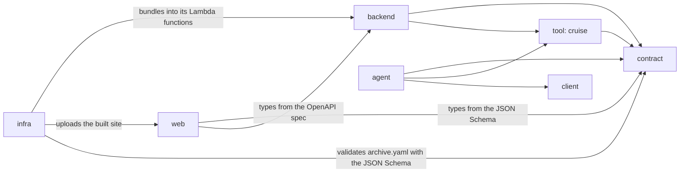
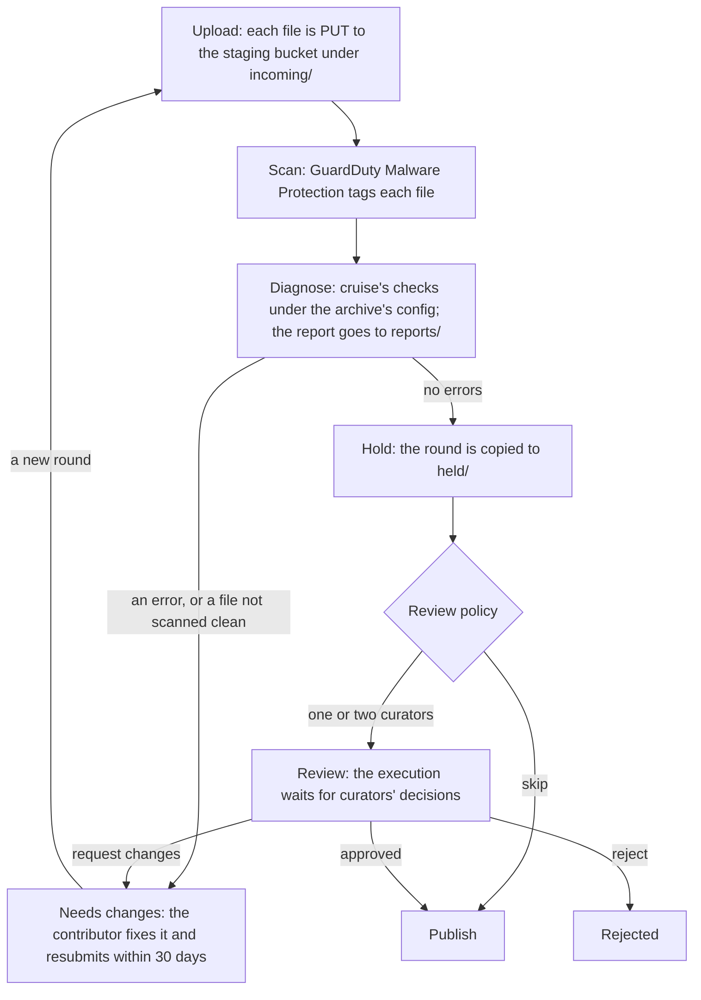

# Architecture

This page is for people who want to change the kit or understand how it is built. It describes the packages and how they depend on each other, how a submission becomes a published dataset, what one stage deploys, and the main design decisions with the reason for each. For running an archive, start with the [README](../README.md) and the [guide](guide/deploying.md).

## Terms

A **package** is a folder holding a dataset's data files, a manifest called `datapackage.json` that describes them, and `checksums.sha256`, which holds a SHA-256 checksum of each file. [`examples/sample-package`](../examples/sample-package) is one. The manifest is a [Frictionless Data Package](https://datapackage.org/) with a few additions, each under the `archive:` prefix, such as `archive:methods`.

A **finding** is one problem a check reports about a package, with a severity (`error`, `warning` or `note`), where it is, the evidence and a fix. For example, `field.description-missing` on the column `logger.battery_v` of the sample package is a warning.

A **stage** is one deployed copy of the archive, such as `prod` or `dev`, with its own site, storage and accounts. The stages are listed in `archive.yaml`, the one file that configures an archive.

A **submission** is one package sent to a stage for publishing. Each time the contributor sends it again after a change, that is a new **round** of the same submission.

## The packages

The repository holds seven packages: five in Python, in a uv workspace, and two in TypeScript, in an npm workspace.

| Package | Language | What it is |
| --- | --- | --- |
| `contract` (`archive-contract`) | Python | The Pydantic models of a manifest and of `archive.yaml`, the profiles (`core` and `ecology`) that say which fields an archive requires, the finding model, the review policy, and the EML, DataCite and schema.org conversions. It writes the JSON Schema the other languages read. |
| `tool` (`cruise`) | Python | The command-line tool: `cruise diagnose`, `audit` and `set`. It holds the quality rules and the score. |
| `backend` (`archive-backend`) | Python | The code of every Lambda function: the API, the ingest pipeline, the reindex, curation, access requests and the scheduled jobs. |
| `client` (`archive-client`) | Python | Browser sign-in to an archive, giving a command-line program a short-lived token. |
| `agent` (`archive-agent`) | Python | The Claude Code plugin: the MCP server `archive-mcp` and the skills `find-data`, `submit-dataset` and `review-submission`. |
| `infra` | TypeScript | The CDK construct `ResearchArchive`, which builds a whole stage, and the two CDK apps: the default app, which CI deploys, and the deploy-access app. |
| `web` | TypeScript | The React web app, built by Vite to static files. |

They depend on each other like this, where an arrow points from a package to one it uses:

The links between the two languages are generated files, not imports. `just schema` writes the contract's JSON Schema to `packages/web/src/schema/archive-contract.schema.json`, and the TypeScript type of `archive.yaml` that the construct uses from it. `just openapi` writes the API's OpenAPI spec from the backend's routes, and `just web-types` turns both into the web app's types. `just check-schema`, part of `just check`, fails when any of these differs from what the code would write now.

## From submission to published dataset

A contributor submits a package from the web app or from the Claude Code plugin. Each submission runs as one execution of the durable ingest function, named by the submission's id, from the first upload to its end.

1. **Upload.** The submissions API hands out one presigned PUT per file, each requiring the file's SHA-256, and the files land in the staging bucket under `incoming/<submission>/<round>/`. Then the API starts the ingest execution.
2. **Scan.** GuardDuty Malware Protection for S3 scans every new object under `incoming/` and tags it with its result. The ingest waits until every file of the round has a tag, backing off up to an hour between checks; a file still unscanned after a day fails the submission with an alert to the admins.
3. **Diagnose.** If the scan found nothing, the ingest downloads the round and runs `cruise.diagnose` on it with the archive's `archive.yaml`, so the server applies the same rules `cruise --config archive.yaml` applies on the contributor's laptop. The report goes to the staging bucket under `reports/`, where the web app shows it. Any `error` finding blocks the round, and so does any file the scan did not report clean: the submission is marked as needing changes, and the execution waits up to 30 days for the contributor to resubmit.
4. **Review.** A round with no errors is copied to `held/` and matched against the review policy, which an admin sets in the web app's Settings. The policy says whether the round is reviewed, by one curator or two. While it waits for decisions, the execution reminds the curators on the policy's days and marks the submission stale after its last day. A curator approves, rejects, or requests changes, which sends it back to the contributor for another round.
5. **Publish.** An approved round, or one the policy lets through without review, is published in a series of steps, each safe to repeat: claim the next version number; fill in the manifest and regenerate its README and checksums; copy the files to the archive bucket's private folder `publishing/<dataset>/<version>/`, writing the manifest last and checking each copy against `checksums.sha256`; write the version's download zips beside them; move the files and zips to `open/` for public data or `restricted/` for the rest, the manifest last, deleting each private copy once its copy is checked; write the version's items into the active catalog table, which is the step that makes the version live; write the dataset's HTML page; register a DOI if the module is on; rewrite the catalog file and the sitemap; and finish. Nothing serves or lists `publishing/`, so until the move a version that is not finished is at no address a reader, CloudFront's cache or a reindex can reach; a publish that fails before the version is live removes what it wrote of it from all three folders.
6. **Reindex.** Everything outside the archive bucket can be rebuilt from it. `just reindex <stage>` starts a durable function that reads every published manifest, bulk-loads the catalog items into whichever of the two catalog tables is not in use, switches to that table only when the load completes, and then rewrites the catalog file, the sitemap and every dataset's page. Publishing does not need it; it is the repair and migration path.

Every wait in an execution is capped so that a submission still open after 360 days ends as `expired`, before the one-year limit on a durable execution would end it without a record. A step that fails after its retries ends the submission as `failed` and alerts the admins.

After publishing, curators and admins can correct, withdraw, restore and embargo a dataset. Each of those records the change at once and hands the file moves to a separate lifecycle function, as [curating.md](curating.md) describes.

## What a stage deploys

All of a stage is one CloudFormation stack, `ResearchArchive-<stage>`, built by the `ResearchArchive` construct. Inside it:

- **Storage:** three S3 buckets. The staging bucket takes uploads (`incoming/`), keeps checked rounds (`held/`) and reports (`reports/`). The archive bucket keeps published data (`open/` and `restricted/`), a version's files while it is being published (`publishing/`, which CloudFront is denied and nothing else reads), each withdrawal's record (`state/`) and project records (`projects/`). The derived bucket keeps the site (`site/`), reindex files (`reindex/`) and CloudFront's logs (`logs/`).
- **Tables:** DynamoDB tables on demand: two catalog tables, A and B, with a parameter naming the active one, and one table per kind of record (submissions, review events, settings, access requests, user profiles, account events, download counts, usage responses).
- **Accounts:** a Cognito user pool. Anyone can sign up with a confirmed email and gets no role; an admin gives roles.
- **API:** an API Gateway REST API under `/api`, with throttling and a Cognito authorizer, in front of the read, submissions, access and curation functions.
- **Web:** one CloudFront distribution serving the web app and dataset pages from `site/`, open data from `open/` under `/data`, and the API under `/api`.
- **Pipeline:** the durable ingest function and GuardDuty Malware Protection on the staging bucket's `incoming/` prefix; the durable reindex function; the lifecycle function.
- **Scheduled jobs:** the daily download rollup from CloudFront's logs, the daily lifecycle sync for ended embargoes, and the weekly integrity check of every archived file against its checksums.
- **Operations:** an alert topic, a monthly budget alarm and a dashboard fed by every function's alarm.
- **Optional modules,** each off by default: WAF on the API and the user pool; S3 Object Lock on the archive bucket; embeddings for semantic search (Amazon Titan Text Embeddings v2 through Bedrock, with a vector index on the catalog tables); DOIs through DataCite; a custom domain, which adds a second stack, `ResearchArchive-<stage>-Certificate`, in us-east-1, where CloudFront takes its certificates from; and email through SES from that domain.

Two more stacks belong to the account rather than to a stage. `ResearchArchiveDeploy` holds GitHub's OIDC provider and the one IAM role GitHub Actions assumes to deploy; it is the only stack deployed from a laptop. `CDKToolkit` is CDK's own bootstrap stack, made once per account and region.

## Design decisions

- **Generic Frictionless packages.** A package is a standard Frictionless Data Package with a few `archive:` additions, and nothing in the core is specific to one field of research, so existing Frictionless tools can read every package, and domain rules live in profiles such as `ecology` that an archive turns on.
- **One set of quality rules, shared by cruise and ingest.** The contract defines the manifest, the profiles and the finding, and `cruise` holds the rules; the ingest runs `cruise.diagnose` itself, so a package that passes on the contributor's laptop passes on the server under the same `archive.yaml`.
- **Durable functions for ingest and review.** A submission can wait weeks for a curator, and a Lambda durable execution checkpoints each step and costs nothing while it waits on a callback, so the whole path is one Python function instead of a separate workflow service.
- **The archive bucket is the source of truth.** The tables, pages, catalog file and search index are derived from the published packages, so any of them can be rebuilt by one reindex.
- **A static catalog file plus a search index.** Each publish rewrites `catalog.json`, one row per dataset, which the API reads into memory to search with keywords, facets, dates and a bounding box; this needs no search service, and the optional vector index adds semantic search on top.
- **CI-only deploys.** Only GitHub Actions deploys a stage, through a role that trusts nothing but the repository's own GitHub environments, so every deploy is built from `main` the same way and no laptop holds standing deploy credentials.
