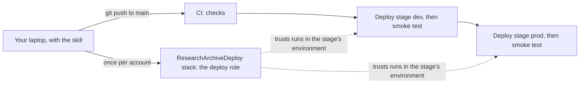

# Deploying an archive

This page explains how an archive gets from your fork of this repository into your own AWS account, what each step of the deploy skill does and why, how to take in later changes from upstream, and how to tear a stage down.

## The supported path: the skill and CI

Two things deploy an archive, and they are the supported path:

- **The `deploy-archive` skill**, in [`.claude/skills/deploy-archive/SKILL.md`](../../.claude/skills/deploy-archive/SKILL.md). A **skill** is a set of instructions [Claude Code](https://claude.com/claude-code) follows when you ask for that task. Open your fork in Claude Code and ask it to set up the archive: the skill checks what you need, writes `archive.yaml` with you, connects GitHub to your AWS account, and stops before every step that changes something, saying what it does and what it costs, until you say yes.
- **CI**, the GitHub Actions workflow in [`.github/workflows/ci.yml`](../../.github/workflows/ci.yml). It runs the checks on every push, and on a push to `main` it deploys each stage. You never run `cdk deploy` on an archive stack yourself.

The skill's file is plain text, and every command it runs is written there, so you can read exactly what it will do before you start. What isn't supported is deploying an archive's stack other than through CI (running the CDK app on it from a laptop, or from another pipeline): the deploy role, the GitHub environments and the teardown all assume CI deploys. The setup around that deploy needs no Claude Code: [Doing it by hand](#doing-it-by-hand) lists the same commands for you to run yourself.

A **stage** is one deployment of the archive, such as `dev` or `prod`: its own AWS CloudFormation stack, named `ResearchArchive-<stage>`, with its own site, accounts and data. `archive.yaml` lists the stages, and CI deploys them in that order, the next only after the last succeeded.



## What you need

- **An AWS account** you can sign in to from the AWS CLI, with permission to create IAM roles and CloudFormation stacks. [Running cost](running-cost.md) explains what it will bill for.
- **A fork of this repository on GitHub**, cloned to your computer, with GitHub Actions turned on for it, and the [GitHub CLI](https://cli.github.com/) (`gh`) signed in.
- **Claude Code**, to run the skill. Without it, [Doing it by hand](#doing-it-by-hand) has the commands the skill runs.
- **[uv](https://docs.astral.sh/uv/), Node 24 or later and [just](https://just.systems/)**: uv runs the Python packages, Node the CDK app and the web build, and just the repository's recipes, such as `just check`.

## Setup, step by step

Ask Claude Code to set up the archive, and the skill walks through these steps. A step marked ✋ waits for your yes.

### 1. Prerequisites

The skill checks that uv, Node and just are installed, that the AWS CLI is signed in (and asks whether it is the right account), that `gh` is signed in, that the clone's `origin` is your own fork rather than the upstream repository, and that Actions is on for the fork. It then installs the repository's dependencies with `uv sync --all-packages` and `npm ci`.

### 2. The config

The skill writes `archive.yaml` with you, reading each setting, its default and its description from the contract's JSON Schema, so it never offers a setting that doesn't exist. [The archive.yaml reference](archive-yaml.md) lists the same settings. It asks about the archive first (the publisher, the alert email, the monthly budget, the profiles), then each optional part with its default: the brand, DOIs, a domain and SES email per stage (until AWS grants the account SES production access, email reaches only addresses verified in SES, so invitations to anyone else don't arrive), and the WAF, object lock and semantic search modules. For DOIs it asks for each stage whether it registers test or live DOIs, and writes a live stage's own `doi` block. It validates the file before going on.

### 3. ✋ Connect GitHub to AWS

CI needs to deploy into your account without any long-lived AWS key stored in GitHub. It does that with **OIDC**: each GitHub Actions run gets a short-lived token, signed by GitHub, that says which repository and environment the run belongs to, and AWS swaps it for temporary credentials of a role that trusts that exact statement.

This step deploys the one stack you deploy from your laptop, **`ResearchArchiveDeploy`**: GitHub's OIDC provider in IAM (or the account's existing one, left as it is) and a deploy role that may only assume CDK's own deploy roles. It also bootstraps CDK in the account and Region if that hasn't been done, which makes a `CDKToolkit` stack with a small S3 bucket.

The role trusts a run only when it comes from your fork and runs in a GitHub **environment** named for one of your stages. The skill creates one environment per stage, lets only the `main` branch deploy from it, and stores in it the role's ARN (`AWS_DEPLOY_ROLE_ARN`) and the stage's Region (`AWS_REGION`). To require a person's approval before `prod` deploys, add a required reviewer to the `prod` environment in the fork's settings.

Anyone who can push to `main`, or change the workflow there, can run code with the deploy role, and that role can do anything in the AWS account. Write access to `main` is admin of the account. The deploy job installs packages without running their install scripts and loads the role only in the step before `cdk deploy`, but every step of that job, the build's own tools included, could ask GitHub for the role. Use an AWS account that holds nothing but the archive, and give write access to `main` only to people you would give the account to.

A stage in another AWS account (an `account` in `archive.yaml`) needs this step again, signed in to that account.

#### The repository's subject, and a recreated repository

The statement in GitHub's token is its **subject**. For an older repository it reads `repo:<owner>/<name>:environment:<stage>`. Repositories created since GitHub introduced immutable subjects carry each name's numeric id as well, such as `repo:example-org@1234567/archive@89012345:environment:prod`, so a repository that is renamed, or deleted and made again under the same name, can't inherit another one's access. The skill reads the subject GitHub sends for your fork:

```
gh api repos/<owner>/<name>/actions/oidc/customization/sub
```

and passes its `sub_claim_prefix` to the deploy as `-c githubSubPrefix=<prefix>`, so the role trusts exactly that.

A recreated repository has new numeric ids, even with the same owner and name, so the deploy role no longer trusts its runs and every stage's deploy fails to assume it. Deploy the `ResearchArchiveDeploy` stack again with the new repository's prefix, by running this step of the skill again, and create the stages' environments in the new repository.

### 4. ✋ The DataCite password

Only with DOIs on. You store the DataCite repository's password yourself, in your own terminal, as an encrypted AWS Systems Manager parameter at `/research-archive/<stage>/datacite-password` in each stage's account and Region. It never passes through the chat, `archive.yaml` or the repository. [DOIs](../dois.md) says how to get a DataCite account.

### 5. ✋ Deploy

The skill commits `archive.yaml`, pushes it to `main`, and follows the CI run. CI runs every check, then deploys each stage in order and runs a **smoke test** on it: a few requests, with no sign-in, that check the site, the API's health, search and a download answer as they should. On the first deploy the archive has no datasets yet, so search, the dataset page and the download print `skipped: no seed yet`; step 8 runs them again once the sample dataset is published. Before you say yes, the skill says what the stage will bill for while idle and per use, and what it adds to your hosted zone when a stage has a domain or SES email.

A stage whose environment has no `AWS_DEPLOY_ROLE_ARN` is skipped with a notice in the run, so a stage left out of step 3 is easy to spot.

### 6. ✋ The first admin

The skill invites the first person to the stage with:

```
just invite-user <stage> <email> admin,curator,contributor
```

Cognito, the AWS service that holds the archive's accounts, emails them a temporary password. A **role** decides what a signed-in person can do: a **contributor** submits packages, a **curator** reviews them, and an **admin** changes the settings, people and access. The first admin gets all three.

Sign-up is open unless the stage says `selfSignUp: false`: anyone can create an account on the site's sign-in page. A new account has no role, so it can download `limited` datasets and ask for `restricted` ones, but can't submit, review or change anything until an admin gives it a role, in the site's **Settings › People** or with:

```
just set-roles <stage> <email> contributor
```

`set-roles` makes the person's roles exactly the comma-separated list given; `""` removes every role.

With `selfSignUp: false` only invited people get an account, so `limited` means the people you invited. On a public stage with sign-up on, use `email: ses`.

Giving someone the curator role does not email them about submissions. The archive sends its review messages (a submission is waiting for review, a reminder, a review gone stale) to a notification topic in Amazon SNS, the stage's curators' topic, and a new stage's topic has no one subscribed to it. Subscribe each curator's email address with:

```
just add-curator <stage> <email> <userId>
```

`<userId>` is the account's id in Cognito, its `sub` attribute. With the AWS CLI signed in to the stage's account and set to its Region, this prints it for an account that exists:

```
aws cognito-idp admin-get-user --user-pool-id "$(just _user-pool <stage>)" --username <email> --query "UserAttributes[?Name=='sub'].Value" --output text
```

The curator then gets the messages meant for every curator and those meant for them as a named reviewer, once they confirm the subscription from the email AWS sends them. Without this step nobody is emailed about a waiting submission, and the review queue is the only signal that one is waiting.

### 7. ✋ The seed

```
just seed <stage>
```

publishes the repository's sample package, invented stream temperature readings under CC-BY-4.0 with access `public`, through the archive's own submit-and-publish path. Before it submits anything, a new browser tab opens by itself on the archive's own sign-in page, because the seed submits and approves as the admin, and the terminal never sees the admin's password: the admin signs in there and presses **Sign in the command line**, which hands the sign-in back to the terminal. The terminal says `signing in: finish it on the archive's sign-in page in the browser` while it waits, for up to five minutes. It is then public data on your archive, so the skill asks first. To take it down later, an admin withdraws it from its page, as [Curating published datasets](../curating.md#withdrawing-and-restoring) describes.

### 8. The smoke test

```
just smoke <stage>
```

runs the smoke test again, now with the sample dataset published: the site, the API's health, search, the dataset's page and a download whose SHA-256 hash matches the manifest each print `ok`. The skill then gives you the site's address, from the stack's `SiteDomain` output.

## Doing it by hand

You can run the setup yourself, without Claude Code. This section lists the commands of the skill's steps 3 to 8, in the skill's order, each with what it does; the steps above explain why each is there. CI still does the deploying: by hand means the setup around it, and you still never run `cdk deploy` on an archive stack. A test in `scripts/tests/` fails when a command here differs from the skill's, so the two stay the same.

Do steps 1 and 2 first. Check that you have everything under [What you need](#what-you-need), run `uv sync --all-packages` and `npm ci` in your clone, then write `archive.yaml` from [the reference](archive-yaml.md) and validate it as [Checking your file](archive-yaml.md#checking-your-file) shows. Replace each `<name>` in the commands below with your own value; `<owner>/<name>` is your fork on GitHub.

### Connect GitHub to AWS

Run these once for each AWS account your stages use, signed in to that account.

Bootstrap CDK in the account and Region, unless `aws cloudformation describe-stacks --stack-name CDKToolkit` shows it is already there. A stage with a `domain` in a Region other than us-east-1 needs the same in us-east-1, where its certificate is made.

```
cd packages/infra && npx cdk bootstrap aws://<account>/<region>
```

Ask whether the account already has GitHub's OIDC provider, since IAM allows only one. When the answer is `NoSuchEntity`, there is none. When it lists `sts.amazonaws.com`, add `-c githubOidcProvider=existing` to the deploy below, which then uses that provider and leaves it alone. When it lists client ids without `sts.amazonaws.com`, stop: the existing provider doesn't accept AWS STS (the service that hands out the temporary credentials), and changing it is a decision for whoever owns it.

```
aws iam get-open-id-connect-provider --open-id-connect-provider-arn arn:aws:iam::<account>:oidc-provider/token.actions.githubusercontent.com --query ClientIDList --output text
```

Read the subject GitHub sends for your fork. When the answer has a `sub_claim_prefix`, that value is the `<prefix>` of the deploy below. When it says `"use_default": true` with no `sub_claim_prefix`, leave `-c githubSubPrefix=<prefix>` out of the deploy. When it says `"use_default": false`, stop: the deploy role doesn't support a custom subject.

```
gh api repos/<owner>/<name>/actions/oidc/customization/sub
```

Deploy the `ResearchArchiveDeploy` stack, which holds the OIDC provider and the deploy role. It is the only stack you deploy from your laptop.

```
cd packages/infra && npx cdk --app "npx tsx bin/deploy-access.ts" deploy -c githubRepo=<owner>/<name> -c githubSubPrefix=<prefix> --require-approval never
```

Read the deploy role's ARN from the stack.

```
aws cloudformation describe-stacks --stack-name ResearchArchiveDeploy --query "Stacks[0].Outputs[?OutputKey=='DeployRoleArn'].OutputValue" --output text
```

For each stage in the account, run these four in order. The first creates the stage's GitHub environment, the second lets only the `main` branch deploy from it, and the last two store in it the role's ARN and the stage's Region, which CI reads.

```
gh api -X PUT repos/<owner>/<name>/environments/<stage> --input - <<< '{"deployment_branch_policy": {"protected_branches": false, "custom_branch_policies": true}}'
gh api -X POST repos/<owner>/<name>/environments/<stage>/deployment-branch-policies -f name=main -f type=branch
gh api -X POST repos/<owner>/<name>/environments/<stage>/variables -f name=AWS_DEPLOY_ROLE_ARN -f value=<role-arn>
gh api -X POST repos/<owner>/<name>/environments/<stage>/variables -f name=AWS_REGION -f value=<region>
```

### Store the DataCite password

Only with DOIs on. For each stage, signed in to the stage's account and Region, store the DataCite repository's password as an encrypted parameter. The command reads the password without showing it; type it and press Enter.

```
read -rs PW && aws ssm put-parameter --name /research-archive/<stage>/datacite-password --type SecureString --value "$PW" --overwrite; unset PW
```

Check that it is there, without reading its value. It should list one parameter of type `SecureString`.

```
aws ssm describe-parameters --parameter-filters Key=Name,Values=/research-archive/<stage>/datacite-password
```

### Deploy

Commit the config and push it to `main`. The push is what deploys: CI runs the checks, then deploys each stage in order and smoke-tests it.

```
git add archive.yaml && git commit -m "Configure the archive" && git push origin main
```

Find the id of the CI run the push started. Wait a few seconds and ask again if it prints nothing.

```
gh run list --commit $(git rev-parse HEAD) --workflow CI --json databaseId --jq '.[0].databaseId'
```

Watch the run until it ends. When it fails, `gh run view <run-id> --log-failed` shows the failed step's log, and [Troubleshooting](troubleshooting.md) covers the usual causes.

```
gh run watch <run-id> --exit-status
```

### Invite the first admin

Create the first account with all three roles. Cognito emails the address a temporary password.

```
just invite-user <stage> <email> admin,curator,contributor
```

Read the account's user id, which the next command needs.

```
aws cognito-idp admin-get-user --user-pool-id "$(just _user-pool <stage>)" --username <email> --query "UserAttributes[?Name=='sub'].Value" --output text
```

Subscribe the address to the stage's review messages, and do the same for each curator you add later. The person confirms from the email AWS sends.

```
just add-curator <stage> <email> <userId>
```

### Seed and smoke test

Publish the sample package as the admin. A browser tab opens on the archive's sign-in page: sign in there and press **Sign in the command line**.

```
just seed <stage>
```

Run the smoke test again, now with a dataset published. Every check should print `ok`.

```
just smoke <stage>
```

Print the site's address.

```
aws cloudformation describe-stacks --stack-name ResearchArchive-<stage> --query "Stacks[0].Outputs[?OutputKey=='SiteDomain'].OutputValue" --output text
```

## Updating from upstream

Upstream is the repository you forked. To take in its changes, ask Claude Code to update the archive. The skill adds `upstream` as a git remote if it is missing, fetches it, and shows the commits and any change to the config's schema since your last merge. It merges `upstream/main` (keeping your values when `archive.yaml` conflicts, and showing you any other conflict to decide), walks you through any new setting, runs `just check`, and, ✋ after your yes, pushes the merge to `main`, which deploys every stage.

## Tearing down a stage

Ask Claude Code to tear down a stage, and type the stage's name when it asks. ✋ After your yes it runs:

```
just destroy <stage>
```

which, from your laptop and never from CI:

- checks you are signed in to the stage's `account`, when `archive.yaml` names one;
- stops the stage's running ingest executions, the submissions waiting for review, since they would block the delete; their contributors would have to submit again;
- deletes the `ResearchArchive-<stage>` stack;
- deletes the log groups the stage's functions leave behind, under `/aws/lambda/ResearchArchive-<stage>-`, but not another stage's whose name starts with this one's;
- for a stage with a domain, deletes its certificate stack in us-east-1 and prints the command that removes ACM's validation record from your hosted zone, which is yours to run.

A stage keeps its data unless `archive.yaml` gives it `keepData: false`: its buckets, tables, user pool and logs stay when its stack is deleted, with their data, and they keep billing for storage until you delete them by hand. A stage with `keepData: false` is deleted whole, data included. To delete a kept stage whole, set `keepData: false`, let CI deploy it, then tear it down. [The reference](archive-yaml.md#infrastructurestageskeepdata) has the setting.

Once no stage is left in an account, the skill offers to remove the GitHub connection too: ✋ it deletes the `ResearchArchiveDeploy` stack and the stages' GitHub environments, after which CI can't deploy to that account. The CDK bootstrap stack stays, since other CDK apps may use it.
