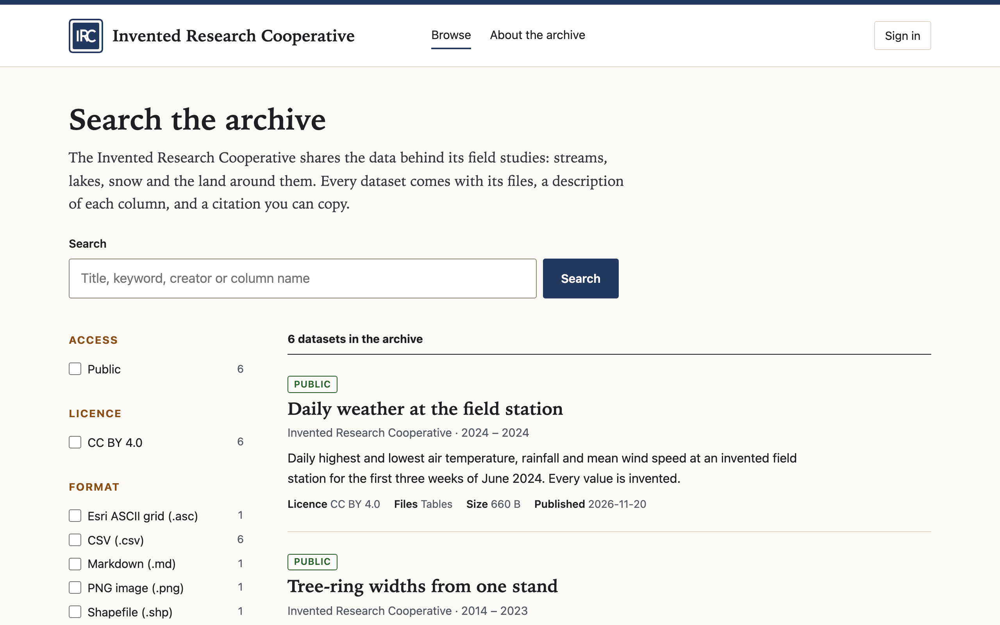
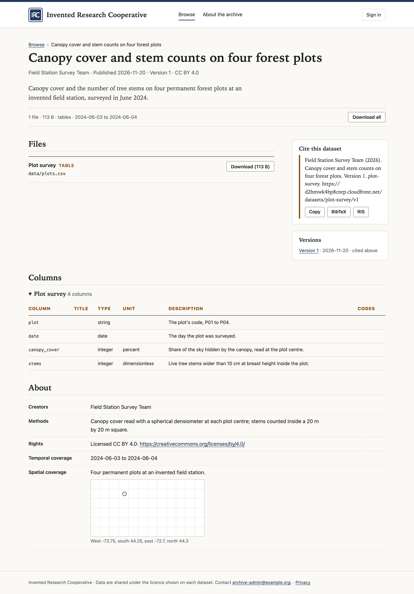
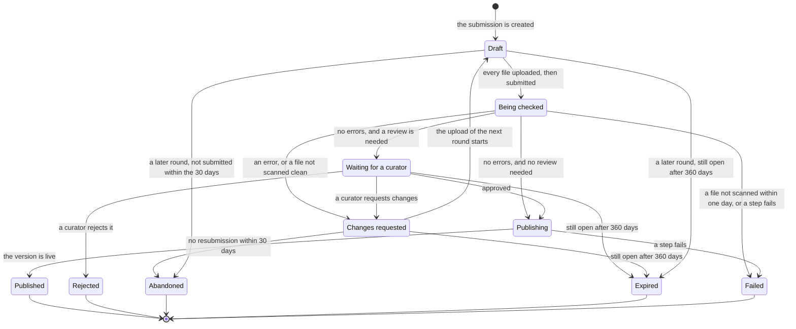
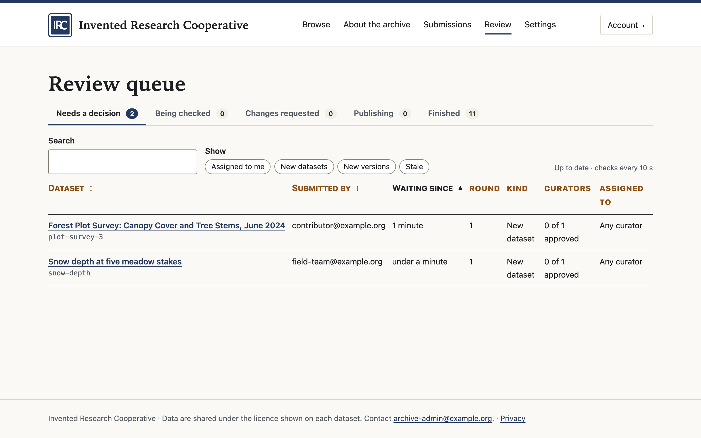
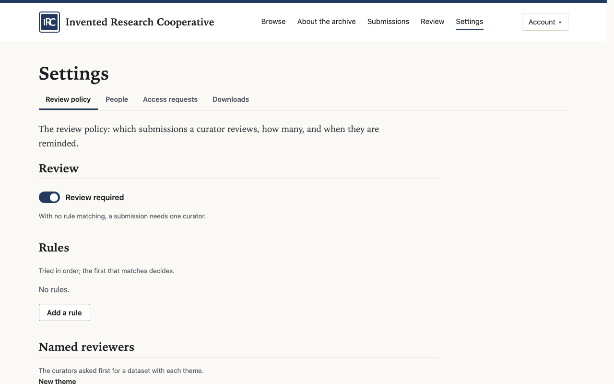

# Using the archive

This page walks through an archive's web app as each kind of person uses it: a reader who finds and downloads data, a contributor who submits it, a curator who reviews it, and an admin who runs the archive. It ends with the About page and the privacy page.

## Accounts and roles

Reading needs no account. Everything else does, and what a signed-in person can do depends on their **roles**:

- a **contributor** submits packages and follows them through review;
- a **curator** reviews submissions and corrects published datasets' details;
- an **admin** changes the archive's settings, people and access, and withdraws, restores and embargoes datasets.

One person can hold any of them; the archive's first admin holds all three. The nav shows **Submissions**, **Review** and **Settings** only to those with the matching role. Opening one of those pages without the role says which role it needs and who to ask.

**Sign in** takes two steps: the email address, then **Continue**, then the password, or **Use a passkey** for an account that has one.

**Sign-up is open unless the archive is by invitation.** Anyone can create an account with **Sign in**, then **Create an account**: an email address and a password, confirmed with a code sent to that address. On an archive by invitation ([`selfSignUp: false`](archive-yaml.md#infrastructurestagesselfsignup)) the sign-in page says *Accounts are by invitation*, and an admin invites people. A new account has no role. It can download `limited` datasets and ask for `restricted` ones, as a reader, but it can't submit, review or change anything until an admin gives it a role (see [People](#people) below).

**Account**, from the menu, is where a signed-in person changes their password, adds or removes **passkeys** (a way to sign in with the device's own lock, such as a fingerprint, instead of a password), and signs out.

## Reader

### Browsing and searching

The front page, **Browse**, lists the archive's datasets, with the archive's introduction above them when it has one.

The search box takes a title, a keyword, a creator or a column name. Beside the results, filters narrow them by:

- **Access**: who may download the files (see [Access levels](packages.md#access-levels));
- **Licence**, such as CC-BY-4.0;
- **Format** of the files, such as CSV or a shapefile;
- **Project**, for datasets that belong to one;
- **Years**: the years the data covers, from and to.

Each result shows its access level, its title, its creators and years, its licence, the kinds of files it holds, its size and when it was published. With the archive's semantic search module on, a search also finds datasets whose descriptions mean the same thing in other words.

A newly published dataset can take a few minutes to appear on Browse and in search, because the search reads a list of datasets that is rewritten at the end of each publish and kept for a minute between reads. Its own page is live as soon as it is published.

### A dataset's page

A dataset's page, at `/datasets/<id>`, shows:

- the title, the version shown, and the total downloads once there are any;
- **Files**: each file with its size and a **Download** button, and **Download all** for the whole package as one zip file;
- **Columns**: each table's columns with their descriptions, types, units and code lists;
- **About**: the creators, the purpose, the methods, the funding and related publications and data, where the package gives them;
- **Cite this dataset**: the citation, with **Copy** and BibTeX and RIS files for reference managers;
- **Versions**: every published version, each at `/datasets/<id>/<version>`, so a citation of an older version still leads to it;
- **Corrections**: each correction made since publishing, with its date and note.

After a download starts, the archive may ask once per visit, "how will you use this data?": the kind of organisation and the purpose, both optional. It never blocks the download and asks for nothing that identifies the reader. **No thanks** or Escape closes it.

### When the files aren't public

A dataset that isn't `public` says so above its files:

- **`limited`**: the files need an account. A signed-out reader sees **Sign in**, and **Create an account** unless the archive is by invitation.
- **`restricted`**: the files are shared with people an admin approves. A signed-in reader presses **Request access**, says what they will use the files for (the admins read this), and presses **Send request**. The page then shows the request as waiting, and later as approved, with the files to download, or declined, with **Request access again**.
- **`description-only`**: the archive holds the description of this dataset, not its files.
- **An embargo**: the page says "Files available from <date>" and each file shows the date instead of a Download button, whatever the access level, until the date passes.

A withdrawn dataset's page stays, with its citation and the reason it was withdrawn, but its files are no longer served.

## Contributor

### Submitting a package

A **submission** is one package sent to the archive for review. Make the package first, and check it with `cruise`, as [Packages and cruise](packages.md) describes.

Check it with the archive's own rules too, not only `cruise`'s defaults: run `cruise diagnose --config archive.yaml <folder>` with the archive's `archive.yaml`, or `--profile` with the profiles it uses, as [Profiles and the archive's own rules](packages.md#profiles-and-the-archives-own-rules) describes. An archive that uses the `ecology` profile, for example, sends a package with no `archive:temporalCoverage` straight back as **Changes requested**, even when plain `cruise diagnose` says it is publishable.

**Submissions**, then **Submit a package**, asks for the package's folder: drop it on the page or press **Choose folder**. The folder needs `datapackage.json` and `checksums.sha256` at its top, and the manifest needs an `id`: the page refuses a package without one, saying "datapackage.json has no id the archive can use." The `id` becomes the dataset's address, `/datasets/<id>`, and a package whose `id` is already published goes in as that dataset's next version ([Write a first manifest](packages.md#1-write-a-first-manifest) explains it). A package's files may total up to the archive's limit (9 GiB unless the archive set less), each file up to 5 GiB, up to 1,000 files; the page says the limit under the folder box, and it and the Claude Code plugin refuse a larger package before uploading anything. Nothing leaves your computer until you press **Upload and submit**. Before that, the page checks every file against `checksums.sha256`, lists any file the checksums don't name (it isn't sent), and runs **Checks before upload**, the same rules `cruise` runs on the manifest. A finding about a column's description or unit can be fixed right there, and the fix goes into the upload. **Upload and submit** stays on even when the checks show an error, but an error there means the submission will come back as **Changes requested**, so fix it first.

After the upload the archive scans the files, runs every check on the data itself, and the submission goes to review, or back to you when an error needs fixing first.

### My submissions

**Submissions** lists your own submissions with the dataset, the status, the kind (a new dataset, or a new version of one), when it started and its last change. A submission's page shows its status, its checks and its history. The statuses:

- **Draft**: not every file was uploaded, or the upload links ran out; choose the folder again.
- **Being checked**: the archive is scanning and checking the files.
- **Changes requested**: the checks found an error, or a curator asked for changes with a note. **Resubmit** sends the fixed folder as the next round. A submission with no resubmission within 30 days is **abandoned**.
- **Waiting for a curator**: the checks passed and a curator decides next. While it waits, you can still fix a column's description or unit from the findings on the submission's page, without a new round.
- **Publishing**, then **Published**: the curator approved it (or the review policy let it through without review) and the dataset is live.
- **Rejected**: a curator declined it, with a note saying why.

A submission still open 360 days after it was first submitted is closed as **expired**; one the pipeline couldn't finish is **failed**.

A new version of a published dataset is submitted the same way, from the folder of its next version.

## Curator

### The review queue

**Review** is the queue of every submission past draft, split into tabs, each with its count:

- **Needs a decision**: in review, waiting for a curator;
- **Being checked**: the archive is still checking them;
- **Changes requested**: waiting for the contributor;
- **Publishing**: approved and being published;
- **Finished**: published, rejected, abandoned, expired or failed.

Above the list, **Search** finds a submission by its dataset's title or id, or its submitter, and the **Show** filters narrow the tab to submissions **Assigned to me** (where you are a named reviewer for the dataset's theme), **New datasets**, **New versions**, or **Stale** ones, waiting longer than the review policy allows. The list can be sorted by dataset, submitter or how long it has waited. The queue reads itself again every 10 seconds while the tab is open, and marks a submission that just arrived. The tab, the search, the filters and the sort are kept in the page's address, so a link to a filtered queue opens it the same way.

### Reviewing a submission

A submission's review page shows its files (with the first rows of a table as a preview), its checks and its history. A curator decides with:

- **Approve**: it publishes, unless the review policy wants a second curator's approval, in which case it waits for one;
- **Request changes**, with a note the contributor reads: it goes back to them;
- **Reject**, with a note: it ends.

### Correcting a published dataset

A curator or admin sees **Correct details** on a published dataset's page, to fix its description, keywords, creators, related works, funding or methods with a note saying what changed. [Curating published datasets](../curating.md#correcting-details) explains what can and can't change without a new version.

## Admin

**Settings** holds four tabs.

### Review policy

**Review required** decides what happens to a submission no rule matches: one curator reviews it, or it is published without review. **Rules** are tried in order and the first that matches decides: each can match the submitters, whether it is a new dataset or a new version, its access level and its themes, and decides whether it is published without review, needs one curator, or needs two different curators. **Named reviewers** are the curators asked first for a dataset with a given theme; their submissions show under **Assigned to me**. **Reminders** set the days after entering review on which the curators are reminded, and the day a waiting review is marked stale.

A curator may approve their own submission: no rule stops it, and its history marks the decision "(their own submission)". To have someone else review a person's submissions, add a rule that matches those submitters and needs two different curators, so at least one other curator approves it too.

### People

**People** lists every account with its email, its roles and its status (invited, signed up, active or disabled). **Invite someone** creates an account with roles chosen up front, and emails the person a temporary password. **Change roles** sets a person's roles, **Resend invite** sends a new temporary password to someone who hasn't signed in yet, and **Disable** signs the person out everywhere and stops their downloads, until **Re-enable**. You can't remove your own admin role or disable yourself. **Recent changes** lists the latest invitations, role changes and disablings, with who made them.

Anyone can create an account unless the archive is by invitation; a new account has no role until you give one here. From a terminal, `just set-roles <stage> <email> <roles>` does the same as **Change roles**.

Giving someone the curator role does not email them about submissions. The person who deployed the archive subscribes each curator's email address from a terminal, with `just add-curator <stage> <email> <userId>`, and the curator confirms from the email AWS sends ([Deploying](deploying.md#6--the-first-admin) explains the command). Without it nobody is emailed about a waiting submission, and the review queue is the only signal that one is waiting.

### Access requests

**Access requests** lists the requests for `restricted` datasets **Waiting** for a decision, each with the person, the dataset and their reason, to **Approve** or **Decline**, and the **Approvals** already given, each of which can be taken back with **Take back**. Each admin also hears of new requests by email, once they confirm the subscription AWS sends when they are given the admin role.

### Downloads

**Downloads** shows each dataset's downloads per month, over the last 3 months, the last 12 months or all time, with **Download as CSV** for reports.

### Withdrawing, restoring and embargoes

On a published dataset's page, an admin can **Withdraw…** it with a reason, which takes its files offline and out of search while its page and citation stay, and **Restore…** it later. An admin moves an embargo's date with `just set-embargo <stage> <id> <YYYY-MM-DD>`. [Curating published datasets](../curating.md) covers each of these, and deleting a dataset for good.

## The About page

The nav's **About the archive** opens `/about`, a short page that says what the archive is. It shows the archive's introduction, the same text as above the datasets on Browse, or one sentence made from the archive's name when it has none. Under it, when the archive has a contact address, is that address as an email link, for questions and for asking about access to a restricted dataset. Both come from `archive.yaml`: [`brand.intro`](archive-yaml.md#brandintro) and [`brand.contact`](archive-yaml.md#brandcontact).

## The privacy page

Every page's footer links to **Privacy**, at `/privacy`, which says what the archive keeps about the people who use it. The kit's default page covers what the kit itself keeps: request logs with IP addresses, deleted after 90 days, used to count downloads; an account's email address and name; a submission's contributor; and the reason given with an access request. It ends with how to ask to see, correct or delete that, using the archive's contact address. An archive that keeps more, or answers to its own rules, replaces the text with `brand.privacy` in `archive.yaml` ([the reference](archive-yaml.md#brandprivacy)).
